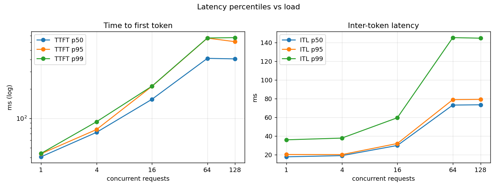

# kvcalc

KV cache VRAM calculator and live monitor for LLM serving: predict memory per model and config, then track real block utilisation on vLLM.

Project 3 of 15 in [inference-infra-portfolio](https://github.com/NomanJafar/inference-infra-portfolio).

## What this builds

A calculator that answers, before a GPU is rented, "how many tokens of context can this GPU hold for this model, and so how many concurrent requests?", and a monitor that shows live KV cache usage next to that prediction so the calculator can be calibrated against reality. [CONCEPTS.md](CONCEPTS.md) has the math.

## Why it matters

Most production OOMs are KV cache math errors, not model size.

## Usage

```bash
pip install "git+https://github.com/NomanJafar/kvcalc"

# predict from a local config.json, or fetch it from the Hub
kvcalc predict --hf Qwen/Qwen2.5-1.5B-Instruct --vram 15 --max-model-len 4096
kvcalc predict --config ./config.json --params 8.03e9 --vram 24 --utilization 0.9 --shared-prefix 1500 --json

# compare well-known models across GPU sizes
kvcalc table --gpus 16,24,80

# watch a running vLLM server against the prediction
kvcalc monitor --base-url http://localhost:8000 --kv-tokens 340064 --interval 1 --duration 0 --out results/timeline.json   # Ctrl-C when the load stops
```

`kvcalc predict` output for Qwen2.5-1.5B-Instruct on a T4 (15 GiB usable, utilisation 0.9, FP16):

```
GPU budget: 15.0 GiB x 0.9 = 13.50 GiB
  weights      2.87 GiB
  activations  0.60 GiB (assumed)
  overhead     0.40 GiB (assumed)
  KV cache     9.63 GiB
KV cache: 28.0 KB/token -> 360,692 tokens (22,543 blocks of 16)
max concurrent requests at 4096 tokens each: 88.1
```

The "assumed" lines are the fuzzy part of the model; the GPU validation below measured them at 1.05 GiB combined on a T4 with vLLM 0.31, and the prediction came out 1.7% high.

## Comparison table (FP16, 4k-token requests, utilisation 0.9)

| model | attn | KV heads | KB/token | 16 GB: 4k-ctx concurrency | 24 GB: 4k-ctx concurrency | 80 GB: 4k-ctx concurrency |
|---|---|---|---|---|---|---|
| meta-llama/Llama-2-7b-hf | MHA | 32 | 512 | 0.4 | 4.0 | 29 |
| meta-llama/Llama-3.1-8B | GQA | 8 | 128 | does not fit | 11 | 112 |
| mistralai/Mistral-7B-v0.3 | GQA | 8 | 128 | does not fit | 14 | 115 |
| Qwen/Qwen2.5-7B-Instruct | GQA | 4 | 56 | does not fit | 29 | 260 |
| Qwen/Qwen2.5-1.5B-Instruct | GQA | 2 | 28 | 96 | 162 | 623 |
| deepseek-ai/DeepSeek-V2-Lite | MLA | 16 | 30 | does not fit | does not fit | 352 |
Three things to notice. Llama-2-7B (MHA, 512 KB/token) "fits" on a 16 GB card with room for 0.4 requests: it loads and falls over under load, which is the failure mode this project exists to prevent. GQA with 2 KV heads makes Qwen2.5-1.5B 18x cheaper per token than Llama-2-7B. DeepSeek-V2-Lite is a 16B-parameter model with a 30 KB/token cache thanks to MLA; the weights are the problem there, not the cache.

Field values in the table come from each model's `config.json` and are embedded in `kvcalc.table.KNOWN_MODELS`; `kvcalc predict --hf` fetches live configs.

## Monitor

`kvcalc monitor` polls `/metrics` and prints, each interval: KV cache usage (and the implied tokens in use against the predicted capacity), running and waiting requests, cumulative preemptions, and generation tokens/s derived from the counter. Waiting > 0 while usage < 100% means the limit is `--max-num-seqs`, not memory; preemptions climbing means the cache is undersized for the load. A JSON timeline is written with `--out`.

## GPU validation

`notebooks/kaggle_kvcalc.ipynb` predicts the KV cache size for Qwen2.5-1.5B at `max-model-len` 2048 and 8192, launches vLLM at each on a T4, and compares the prediction with the server's reported "GPU KV cache size" and "Available KV cache memory"; then it runs the monitor during a `tokenbench` closed-loop sweep to see what caps concurrency. Raw data: [`results/kaggle_run1/`](results/kaggle_run1/).

### Prediction vs vLLM (Tesla T4, 14.56 GiB reported by the driver, utilisation 0.9, FP16)

| max-model-len | predicted KV tokens | vLLM reported | error | predicted KV GiB | reported | predicted concurrency | reported |
|---|---|---|---|---|---|---|---|
| 2048 | 345,936 | 340,064 | **+1.7%** | 9.24 | 9.08 | 168.9 | 166.05x |
| 8192 | 345,936 | 340,064 | **+1.7%** | 9.24 | 9.08 | 42.2 | 41.51x |

Bytes per token (28,672) is exact; the 1.7% comes from the two assumed terms. Weights actually loaded at 2.98 GiB against the 2.87 GiB that 1.54B x 2 bytes gives (the parameter count in model cards is rounded and excludes some buffers), and activations + overhead came to 1.05 GiB against the assumed 1.0. Backing out of vLLM's numbers: 14.56 x 0.9 − 2.98 − 9.08 = **1.05 GiB** of non-weight, non-cache memory on this stack, which is now the calibrated default for a T4 with vLLM 0.31.

**The KV cache size did not change with `max-model-len`.** 340,064 tokens at 2048 and at 8192: vLLM sizes the cache from the memory left after profiling with `max-num-batched-tokens`, not from the context length; `max-model-len` only changes how many requests of that length fit (166x vs 42x). This is why `kvcalc` reports capacity in tokens and derives concurrency separately.

### Monitor during a sweep (4096 max-model-len, 1024-token prompts, 256 output tokens, 64 requests per level)

| level | req | err | out tok/s | TTFT p50 | TTFT p95 | ITL p50 | ITL p95 | TPOT p50 |
|---|---|---|---|---|---|---|---|---|
| 1 | 64 | 0 | 56 | 41 ms | 44 ms | 17.8 ms | 20.3 ms | 18.4 ms |
| 4 | 64 | 0 | 207 | 72 ms | 77 ms | 19.1 ms | 20.2 ms | 19.6 ms |
| 16 | 64 | 0 | 522 | 157 ms | 213 ms | 30.0 ms | 32.1 ms | 30.8 ms |
| 64 | 64 | 0 | 853 | 411 ms | 662 ms | 73.3 ms | 79.0 ms | 75.2 ms |
| 128 | 64 | 0 | 851 | 406 ms | 608 ms | 73.6 ms | 79.4 ms | 75.5 ms |



Per-level peaks from the server's own `/metrics` (sampled by tokenbench): running 1 → 4 → 16 → 64 → 64; **waiting 0 at every level**; KV usage 0.4% → 0.6% → 1.6% → 5.4% → 5.4%.

### What the numbers say

1. **Nothing capped concurrency here except the test itself.** `waiting` never left zero and the cache never exceeded 5.4%: both limits from CONCEPTS.md section 3 were far away. The "128" row equals the "64" row because the sweep was run with 64 requests per level, so at most 64 were ever in flight (tokenbench now raises the request count to cover the concurrency; see its README). The T4's compute saturated first: ITL went 17.8 → 73 ms and throughput plateaued at ~850 tok/s.
2. **KV usage at 64 was 5.4%, not the 24% the arithmetic predicts (64 x 1,280 tokens / 340k).** vLLM 0.31 enables prefix caching by default and every request used the same 1,024-token prompt, so the prompt blocks were shared and only the 256 generated tokens per request cost new blocks: 64 x 256 + 1,024 ≈ 17.4k tokens ≈ 5.1%. The monitor showed the prefix-caching effect (project 4) before that project exists. For memory sizing, test with varied prompts or `--no-enable-prefix-caching`.
3. **Long prompts make decode stutter.** With 1,024-token prompts, ITL p99 reached 145 ms at 64 users against a p50 of 73 ms: new requests' prefills interleaving with decode steps (chunked prefill, project 8). The servellm sweep with 256-token prompts showed a much tighter p95 (42 ms at 64).
4. **The 1.7% error is in the fixed terms, not the per-token math**, so it does not grow with context length or batch size. For capacity planning, a 2% margin on top of the prediction is enough on this stack.
5. **A monitor with a fixed duration is the wrong tool for a sweep of unknown length.** The standalone `kvcalc monitor` ran for 420 s and ended during the 4-user level because level 1 alone took 320 s (64 serial requests at ~5 s each). The per-level numbers above come from tokenbench's sampling instead. `kvcalc monitor` should be run with `--duration 0` and stopped when the load stops; the README example now says so.

### What was not measured

Preemption behaviour (the cache never filled; project 9 forces that); a model where weights, not cache, dominate; varied prompts without prefix sharing.

## Layout

```
CONCEPTS.md           memory accounting, bytes per token for MHA/GQA/MLA, concurrency math, why servers OOM
src/kvcalc/
  calc.py             ModelSpec.from_config, kv_bytes_per_token, capacity
  table.py            KNOWN_MODELS and the comparison table
  monitor.py          /metrics polling and timeline
  cli.py              predict | table | monitor
tests/                22 tests; the monitor is exercised against tokenbench's mock server
```

## Running the tests

```bash
python -m venv .venv && source .venv/bin/activate
pip install -e ".[dev]"
pytest
```

## Hardware notes

Developed against free-tier GPUs (Kaggle and Colab T4, 16 GB). The activation and overhead defaults (0.6 + 0.4 GiB) are within 5% of the 1.05 GiB measured on that card with vLLM 0.31; other GPUs and versions will need the two assumed terms re-measured the same way.

## License

MIT
